# Syrinx · tests

Quick results per batch: tests, experiments and pictures. Pictures live in `docs/tests/`. Run the
tests with `node tests/engine-test.js`.

**Now: 33 engine tests passing** (about 8 s). Benchmark: `node tools/perf.js`.

## Batch 02 · source core

Experiments before building:

- Mapped the oscillator over tension and pressure: tonal (Hopf) below β ≈ −0.25, rich near onset
  above it (SNILC), as in Perl et al. 2011, Fig. 4.
- Onset line has a closed form; matches the numerical onsets within the scan step.
- One attractor past onset (start state doesn't matter). Above onset, near β = −0.2, the cycle
  coexists with rest (the homoclinic region), so notes start from rest.
- RK4 pitch error vs step: under 0.03 cent at step 0.1 everywhere, 4–26 cents at 0.3–0.4 on the
  sharpest pulses. Chose RK4, step ≤ 0.1.

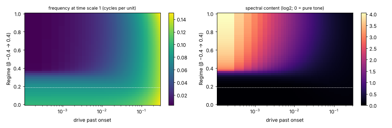

Tests:

- Map: Hopf onset is a quiet pure tone, SNILC onset is near zero frequency and rich (content 17). ✓
- Onset line is where oscillation starts (from rest). ✓
- Pitch within 1 cent across Regime and four notes: worst 0.04 cent. ✓
- Pitch within 1 cent across Pressure: worst 0.004 cent. ✓
- Regime: content 1.04 → 1.91 → 7.96. ✓
- Link, finch fingerprint: content 8 at 500 Hz, 1.9 at 1.5 kHz, 1.04 at 2.5 kHz. ✓
- Same output at buffer sizes 1, 64, 1000. ✓
- No NaN; peaks 0.13–0.50 across Regime and pitch. ✓
- Release ends in silence; engine goes idle. ✓
- Grain: pitch within 0.05 cent at the default, smeared by about 34 cents at full. ✓
- Breath bend starts 1152 cents low with a slow attack. ✓
- Pitch bend, mono glide, poly chord. ✓

Problems found and fixed:

- 8 kHz rich notes aliased: added a band limit (content ≤ 15 kHz ÷ pitch, by adding drive).
- 2-cent map error between rows: interpolation made cubic in both directions, one-sided at the
  Hopf/SNILC corner. Map now agrees with direct integration to 0.01 cent.
- Grain pulled pitch flat by moving the onset: noise now moves along the onset line.
- Pressure barely changed a buzz: widened Pressure to 8 octaves of drive.

Renders (`tools/render-presets.js`), 2–8% of real time each in JavaScript:

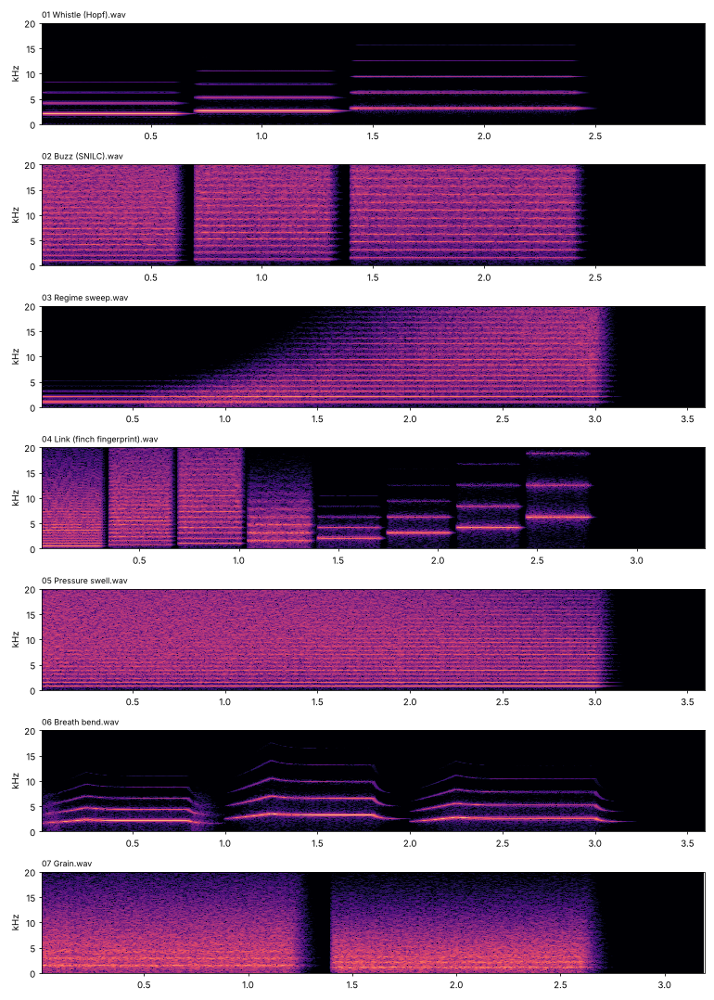

After widening Pressure (Buzz, Link, Pressure swell):

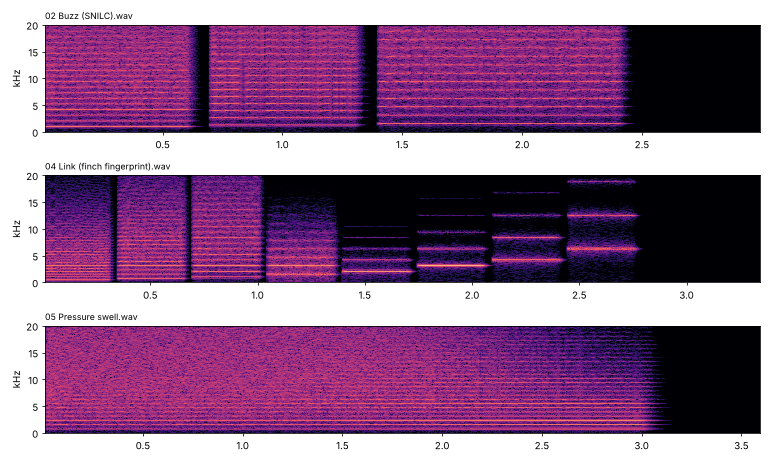

**You:** listen to the renders.

## Batch 03 · cost

- Worst case over notes, Regime and Pressure (Link off): 19 sub-steps per 4× sample, a rich
  2.5 kHz note at Pressure 0. The 48-step cap is never reached (the band limit keeps it under 20).
- Integrators at equal accuracy (0.05 cent): RK4 needs 3–10× fewer evaluations than RK2 or RK3;
  semi-implicit Euler can't hold pitch at any practical step. Kept RK4.
- RK4 step vs worst pitch error over the map: 0.1 → 0.10 cent, 0.125 → 0.26, 0.15 → 0.57,
  0.2 → 1.9. Kept 0.1 (larger saves little).
- `tools/perf.js` (one 2.1 GHz Xeon core, 48 kHz; batch 05 adds rows below):

  | Scenario | CPU |
  |---|---|
  | Silent | 0.1% |
  | 1 voice, tonal | 1.4% |
  | 1 voice, defaults | 2.1% |
  | 1 voice, rich low | 3.0% |
  | 1 voice, worst case | 10.8% |
  | 4 voices, defaults | 6.3% |
  | 4 voices, worst case | 40.0% |

- The same worst-case loop in C++: 9.5% (no faster: each step waits on the last).
- Interleaving independent oscillators in one loop: C++ 1, 2, 4, 8 sources = 9.9, 9.5, 11.1,
  16.6%; JS = 11.4, 11.0, 17.8, 48.5%. Decided: all sources of a voice share one loop.
- Inlining RK4 by hand in JS: about 5% faster (V8 already inlined it). Kept.
- Decided: Poly has 4 voices.

## Batches 04–05 · sources, play modes, coupling, breath, patterns

Experiments:

- Locking: tonal sides 10 cents apart lock at Coupling 0.05; 50 cents apart at 0.1. Rich sides
  resist (50 cents still free at 0.7).
- Identical tonal sides lock in anti-phase at weak coupling (correlation −0.93) and in phase from
  about 0.3: the review's zebra-finch "period doubling" emerges.
- Strong coupling pulls both pitches off their notes (Coupling 1: a pair 7.3 semitones apart
  locks together at 694 Hz).
- Triple: a membrane 2–5 semitones below locks with the labia into one tone between them, lower
  than the labia alone (as in the ovenbird); far below, it rides under the labial tone.
- Single, first try: position coupling made identical folds lock in anti-phase and cancel
  (near silence). Velocity (dissipative) coupling fixed it: folds move together.
- Single detuning: linear Asymmetry pulled the locked pitch up to 57 cents sharp at the default;
  squared Asymmetry keeps the default within 2–18 cents; folds slip into roughness from about
  0.5 (tonal) to 0.7 (rich).
- Cost: running sides one after the other doubled the worst case (22%); one interleaved loop
  brought it to 13.5% (one side 10.7%). New `tools/perf.js` rows:

  | Scenario | CPU |
  |---|---|
  | 1 voice, two sides (Interval, Coupling 0.3) | 3.6% |
  | 1 voice, two sides at the worst case | 13.5% |
  | 1 voice, Triple | 2.9% |
  | 1 voice, Single | 3.8% |
  | 1 voice, pattern 18/s + Wobble | 4.1% |
  | 4 voices, defaults | 9.8% |

Tests (new):

- Handoff: low note left, high note right; a 2 → 7 kHz sweep starts left and ends right. ✓
- Interval 730.00 cents; Duo and Independent put the notes on the right sides. ✓
- Coupling locks sides 10 cents apart; difference tone −164 dB → −24 dB with Coupling 0.3. ✓
- Identical tonal sides: anti-phase when weak, in phase when strong. ✓
- Single: folds lock at Asymmetry 0.2, slip at 0.6. ✓
- Triple: close membrane locks below the labial pitch; far membrane keeps its own; level 0
  silences it. ✓
- Pattern: onsets exact (0 samples error at 4×); same output at buffer sizes 1, 64, 1000 with
  jitter; Sync snaps to beat divisions. ✓
- Gating: silent between syllables while the source runs; Minibreath stops the source between
  slow syllables and fades out above 30 per second. ✓
- Trill limit: a 20/s trill's sweep is cut to Podos's 5070 Hz. ✓
- Alternate switches sides each syllable. ✓
- Wobble: −9.5 dB sidebands at ±160 Hz (amplitude); pitch centre within 1.5 cents (pitch). ✓

Problems found and fixed:

- Each syllable started with a short streak: pitch ramped from the last syllable's end. A
  syllable that starts inside a block now starts at its own first pitch.
- Single folds cancelled (see above).

Sources at work: each side's level in a cardinal sweep, Triple locking, Single slipping:

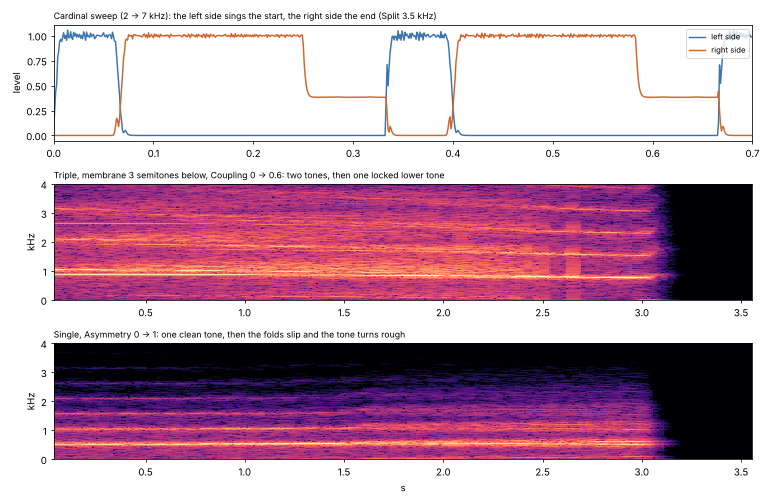

New presets 08–16:

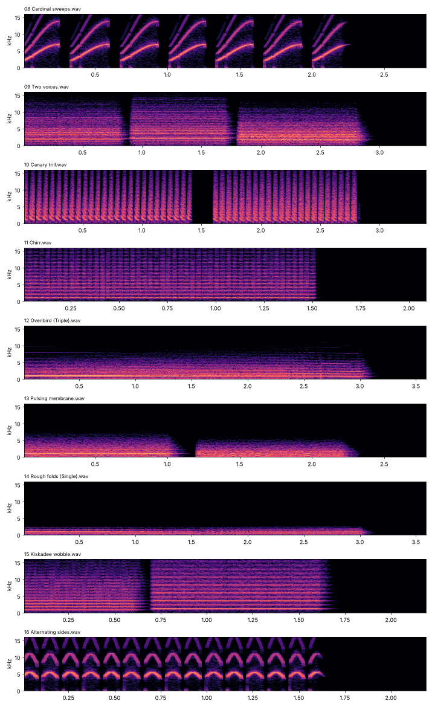

**You:** listen to presets 08–16.

## Batch 06 · internal trachea, Jumps, Chaos, Filter

Experiments:

- Tube feedback strength: linear in Jumps pulled the pitch 600+ cents at mid settings. Squared,
  0.3 × Jumps²: 10 cents at 0.3, a smooth pull at 0.6, jumps near 1.
- Chaos on one source with feedback stayed periodic. It needs two sources, the rich regime and a
  non-harmonic interval (3.3 semitones). Works below about 2 kHz; above, the band limit keeps the
  source pure.
- Filter level against Filter off: −7.5 to +4.8 dB, depending on the note against the tube's
  resonances.

Benchmark after batch 06 (tube always running): 3.2% per voice at the defaults, 12.6% at the worst
case, 14.5% two sides at the worst case, 44% four voices at the worst case.

Tests (new):

- Filter: purer spectrum (content 2.59 → 1.61), pitch unchanged, level −0.9 dB. ✓
- Jumps 0, Filter off: tube length changes nothing. ✓
- Jumps 0.3: pitch pull 10 cents. ✓
- Jumps 1, trachea 4 → 7 → 4 cm on a 3.3 kHz note: a 1195-cent jump, with hysteresis. ✓
- Chaos 1 on a 523 Hz note: periodicity 1.00 → 0.40. ✓
- All new parameters at their extremes stay finite and bounded. ✓

Trachea sweeps (smooth pull at Jumps 0.6; jumps with hysteresis at Jumps 1), Chaos off and on,
Filter off and on:

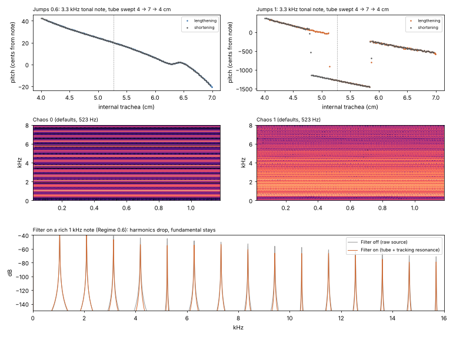

New presets 17–19:

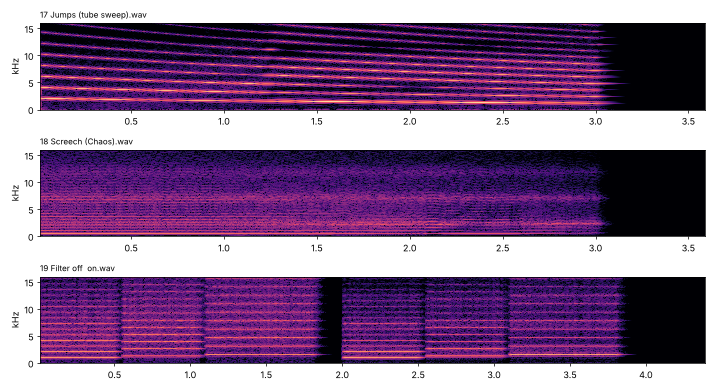

**You:** listen to presets 17–19.

## Batch 07 · musical lock, Size

Experiments:

- The keeper first counted single periods on the raw source. Under coupling the other side's tone
  added crossings, and the keepers of the two sides fought: up to 300 cents off. Fixed with a
  band-pass on each source's own pitch, an 8-period window, and arming relative to the signal's
  amplitude.
- Strong Coupling (above about 0.85) froze a tonal side while the other buzzed near 300 Hz, Lock or
  not. The coupling push is now limited to 80% of the drive.
- How far Lock can hold: Coupling up to about 0.35 (above, the sides merge into one pitch and
  wobble 40 cents), Jumps up to about 0.7 (above, the tube owns the pitch). Lock scales both knobs
  to those ranges.
- Captured sources (a whole tone apart, high up) now settle in unison on a semitone instead of
  winding the correction up.
- After a Stepped step the keeper's band-pass rings for a couple of milliseconds; skipping 4 periods
  after each step took the overshoot from 10 cents to 0.3.

Benchmark: Lock adds about 1% per voice (4.4% for two coupled sides, 14.1% at the worst case).

Tests (new):

- Locked syllables end on a semitone (400.00 cents), start on the note, Jitter moves no pitch. ✓
- Stepped: 99% of periods within 10 cents of a semitone (Smooth 62%). ✓
- Keeper at full Coupling, 28 note and interval pairs: worst 1.0 cent (unlocked up to 880). ✓
- Triple 300 → 0 cents, Single 11 → 0 cents. ✓
- Jumps 1 tube sweep: 96% of windows within 2 cents, worst 8 cents where it would jump. ✓
- Interval 7.3 plays 7; Breath bend only scoops the attack. ✓
- Size: −0.933 octave at 0.6, −1 with Lock; Tempo lock 100% keeps 8/s, 0% slows to 2/s at Size 1. ✓
- Sync: syllables on the beat grid with Jitter 1. ✓
- Stepped glide 98% on semitones (Smooth 20%). ✓
- Same output at buffer sizes 1, 64, 1000 with Lock. ✓

Locked syllables, the keeper at full Coupling, a Jumps 1 tube sweep with Lock off and on:

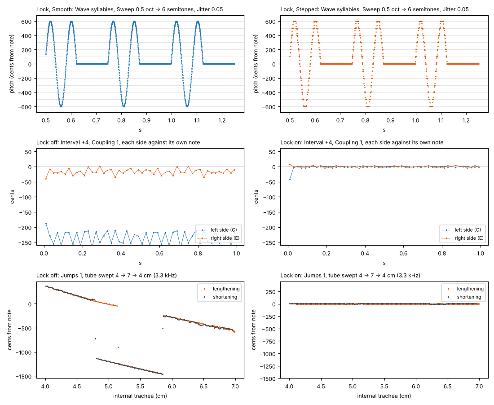

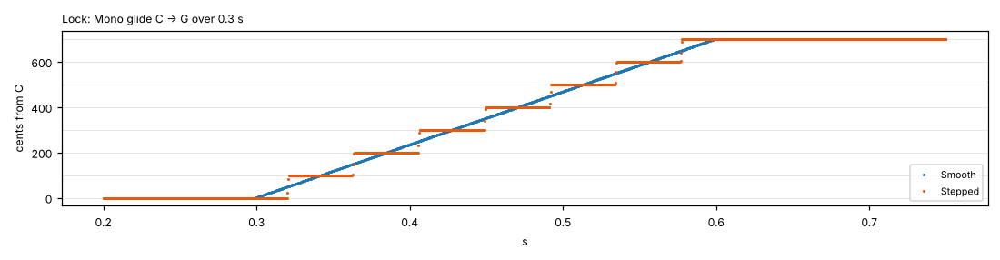

New presets 20–23:

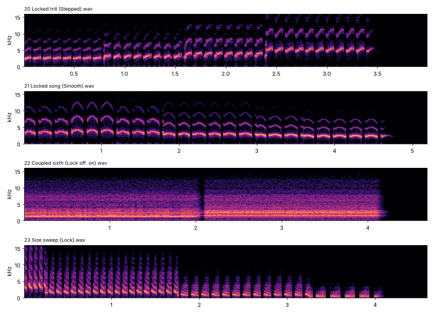

**You:** listen to presets 20–23.

## Batch 08 · bench

`tools/syrinx.html`, built from the reference engine, its map and the presets. Checked in headless
Chromium: it powers on, a held key plays (left source 2.09 kHz, C6), the DSP meter reads, a test
preset plays with Lock on and the keeper readout shows, no console errors, no sideways scroll at
390 px.

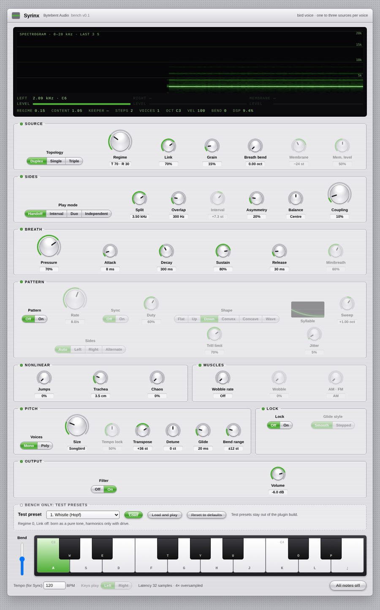

**You:** listening round on the bench; decide the LFOs.
